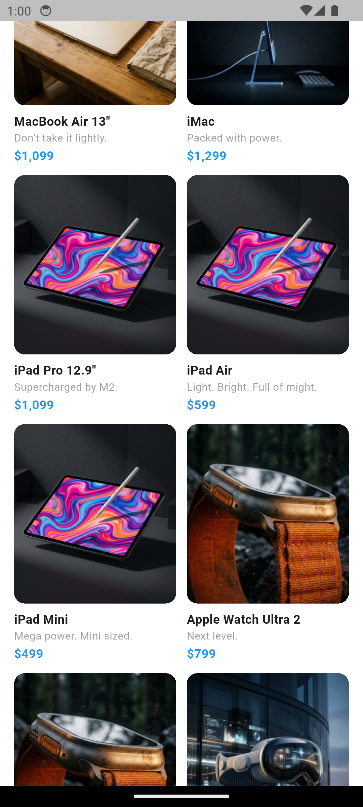
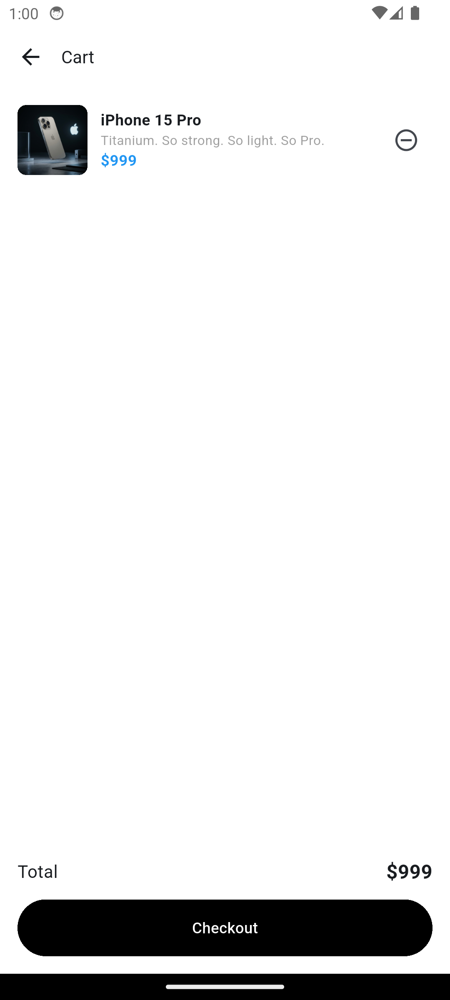
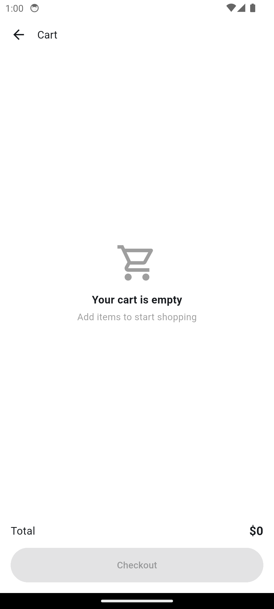

# Mini Katalog

Flutter ile geliştirilmiş basit bir mobil ürün katalog uygulamasıdır. Ürün verileri JSON dosyasından okunur, ürünler ana sayfada kart olarak listelenir, detay sayfasında incelenir ve sepete eklenir.

## Özellikler
- Ana sayfada banner, arama kutusu ve 2 sütunlu ürün kartları (GridView)
- Ürün adına göre arama
- Ürün detay sayfası: görsel, açıklama ve özellikler
- Sepete ekleme, sepetten çıkarma, toplam fiyat
- Sepet boşken özel ekran
- Sayfalar arası geçiş (Navigator) ve Route Arguments ile ürün aktarma

## Kullanılan Teknolojiler
- Flutter 3.47.6 (stable)
- Dart 3.13.5
- Ekstra paket kullanılmamıştır (sadece material.dart)

## Klasör Yapısı
- `lib/models`: Product sınıfı
- `lib/data`: ürünleri okuyan fonksiyon ve sepet
- `lib/pages`: ana sayfa, ürün detayı ve sepet sayfaları
- `assets`: products.json ve ürün görselleri

## Çalıştırma Adımları
1. Projeyi indir: `git clone https://github.com/41baha/mini-katalog.git`
2. Klasöre gir: `cd mini_katalog`
3. Paketleri yükle: `flutter pub get`
4. Android emülatörü ya da telefonu bağla
5. Uygulamayı çalıştır: `flutter run`

## Ekran Görüntüleri

## Veri Kaynağı
Ürün verileri ve görseller eğitim amaçlı wantapi.com üzerinden alınmış, projeye `assets` olarak eklenmiştir.